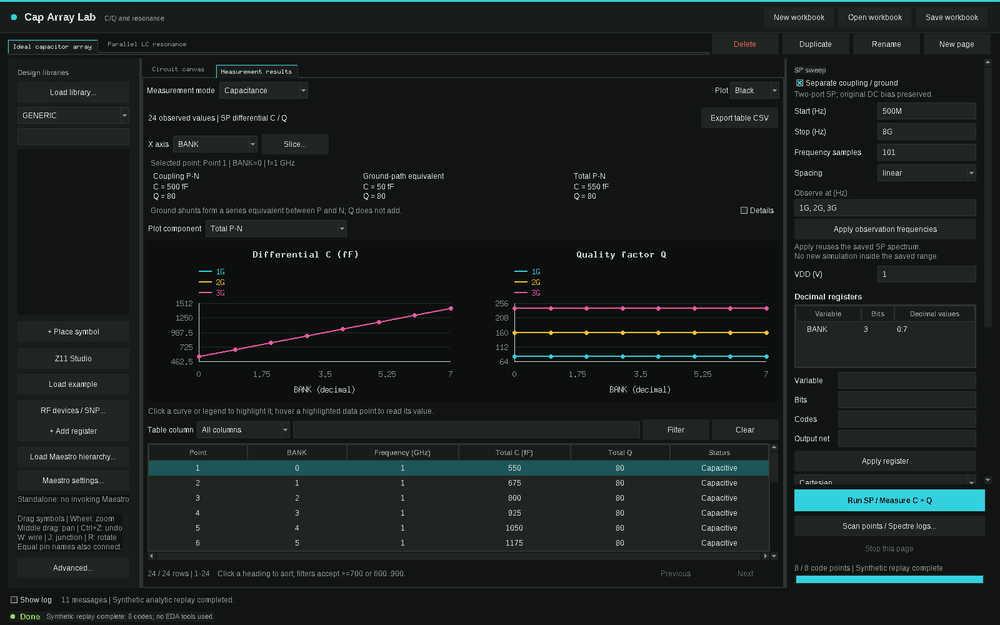

[简体中文](README.zh-CN.md)

# Cap Array Lab

A desktop workbench for capacitor-array C/Q measurements, floating-port parasitic decomposition and RF resonance inspection, including Z11 Studio.



## What it does

- Draw circuits, connect named nets or wires, and scan decimal control registers across independent workbook pages.
- Inspect per-code capacitance and Q, separating coupling, ground-path equivalent and floating P/N total admittance.
- Reuse saved spectra at new observation frequencies, inspect first resonance and plot Z11 magnitude and phase.
- Import Touchstone metadata and place RF components using your own Cadence installation.
- Save self-contained result workbooks and export filtered tables to CSV.
- Open the bundled Z11 Studio for standalone RLC drawing, nodal analysis, linked sweeps and optimization.

## Requirements

The core workbench and synthetic example use Python 3.6+ and Tk 8.5+ with no third-party packages. A graphical display is required. Linux is the supported launch platform.

Z11 Studio additionally requires NumPy 1.17+ and Matplotlib 3.3+. CMA-ES optimization optionally requires `cma`; differential evolution and NSGA use NumPy. On Python 3.6, compatible versions include NumPy 1.19.5 and Matplotlib 3.3.4. Core Tk tests were run with Python 3.6; Z11 GUI validation used an existing modern Python environment. The Z11 numerical solver was also tested with Python 3.6 and NumPy 1.19.5.

Native library browsing, symbol import, SP measurements, module-current loss analysis and schematic creation require your own Cadence Virtuoso/Maestro/Spectre installation, library mappings, device models and licenses. None are included. EMX is not invoked by this product; provide your own Touchstone files for extracted networks.

## Install / Quick start

From the repository root, open the offline example first:

```bash
python3 app.py --project examples/ideal_array.json
```

Alternatively, run `bash launch.sh` and click **Load example**. Select **Ideal capacitor array** for C/Q, or **Parallel LC resonance → Measurement results → Z11 vs frequency** for impedance and phase. **Run SP / Measure C + Q** replays the analytic fixture when an example page is active; its status explicitly identifies synthetic replay. **Stop this page** cancels it. Replay uses a fixed eight-code model and fixed saved frequency grid; editing the circuit does not change that model. Start a new workbook for native work.

The example contains no PDK or simulated device data. Its formulas, units, reproducibility and synthetic Touchstone file are described in [examples/README.md](examples/README.md).

For Z11 Studio, install optional packages in an environment you manage:

```bash
python3 -m pip install -r requirements-z11.txt
bash caplab/z11/z11_launch
```

The **Z11 Studio** button opens the same bundled program. With no workspace it runs offline; with a configured native workspace it uses a source-bound schematic broker. `Z11_PYTHON` may select a separate interpreter. The core interface is English; Z11 retains its original Chinese interface.

## Using with Cadence

Configure your own environment; no site paths or license values are bundled:

| Setting | Meaning |
| --- | --- |
| `CAPLAB_PYTHON` | GUI interpreter; defaults to `python3` on PATH |
| `CAPLAB_WORKSPACE` | Default workspace containing your `cds.lib`; empty by default |
| `CAPLAB_LIBRARY` | Default target library name; defaults to `CAP_DEMO` |
| `CAPLAB_NATIVE_VIRTUOSO` | Native executable; defaults to `virtuoso` on PATH |
| `CAPLAB_CADENCE_ENV` | Optional trusted shell script sourced by the standalone native child |
| `CAPLAB_NATIVE_CDS_LIB` | Optional absolute path to a private library mapping file |
| `Z11_PYTHON` | Optional Z11 interpreter; otherwise uses the current GUI interpreter |
| `CAPLAB_Z11_PATH` | Optional external Z11 installation override; the bundled copy is the default |

Provide your Cadence and license environment yourself. GUI launch isolates Python/Tk library overrides; Maestro launch captures its native environment separately. See [docs/CADENCE.md](docs/CADENCE.md) for the menu entry and configuration details. Native workflows were preserved but were not run for this release.

## CLI for agents

```bash
python3 app.py --help
python3 app.py --project examples/ideal_array.json
python3 -m caplab.demo
python3 -m unittest discover -s tests -p 'test_*.py'
```

`caplab.demo` regenerates both synthetic example files. `--context` is the internal Maestro launch-context entry, not a general netlist runner. Tests requiring Tk skip without `DISPLAY`; use a display assigned to you for full UI tests. The full suite includes NumPy-based Z11 tests. There is no headless native simulation CLI.

## Limitations

- Saved-spectrum interpolation is linear in complex admittance and never extrapolates. Coarse grids can miss narrow/high-Q resonance crossings.
- Floating P/N decomposition is a terminal equivalent, not a physical capacitor inventory. Q values do not add.
- Module loss shares require complete, balanced native current data. The synthetic example deliberately reports these as unavailable.
- Workbook files may contain your own local paths, library identities and results. Review them before sharing. Runtime state is written into ignored `.work/` and `runs/` directories; Z11 has its own saved state.
- The tools do not perform DRC/LVS signoff. Touchstone import accepts supported full-matrix ASCII S-parameter formats; unsupported keywords or changed files are rejected.

## RF-FIELDWORK

Product page: https://rf-fieldwork.pages.dev/cap/?lang=en

Other open-source tools:

- [Flux Studio](https://github.com/chloeyntu-byte/flux-studio): parametric RF passives, EMX sweeps, multi-objective search and SNPFit
- [Layout 3D Viewer](https://github.com/chloeyntu-byte/layout-3d-viewer): read IC layouts in 3D, locate pins and trace connections
- [VCO ISF Explorer](https://github.com/chloeyntu-byte/vco-isf-explorer): ISF, flicker-noise up-conversion and phase-noise contributions
- [Crescendo](https://github.com/chloeyntu-byte/crescendo): automatic device-size optimization inside Cadence Maestro

## License

MIT. See [LICENSE](LICENSE).
