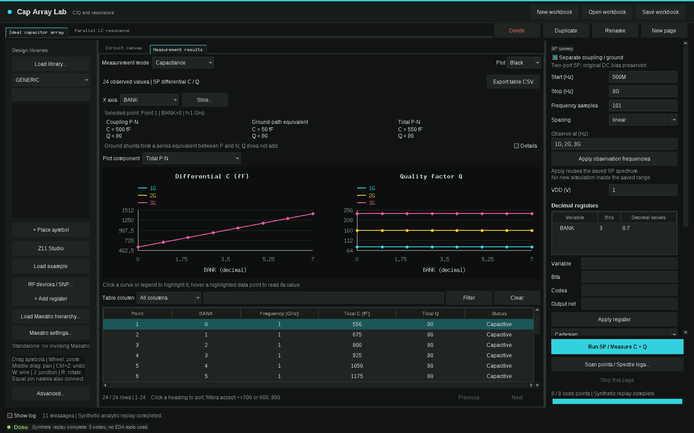

[English](README.md)

# Cap Array Lab

电容阵列桌面测量工作台，支持 C/Q、浮地端口寄生分解与 RF 谐振分析，内含 Z11 Studio。



## 功能

- 在画布搭电路，通过同名网络或连线连接，按十进制寄存器逐码扫描，工作簿各页独立。
- 查看逐码电容与 Q，分解 coupling、ground-path 等效支路及浮地 P/N 总导纳。
- 复用已保存的频谱，调整观察频率，查看首个谐振点以及 Z11 幅相。
- 使用用户自己的 Cadence 环境导入 Touchstone 元数据、放置 RF 器件。
- 保存包含结果快照的工作簿，导出筛选后的 CSV 表格。
- 打开内置 Z11 Studio，独立绘制 RLC 网络、做节点分析、联动扫描及优化。

## 环境要求

主工作台及合成示例需要 Python 3.6+、Tk 8.5+，不需要第三方包。需要图形显示。启动脚本支持 Linux。

Z11 Studio 另需 NumPy 1.17+、Matplotlib 3.3+。CMA-ES 优化可选安装 `cma`；差分进化和 NSGA 使用 NumPy。Python 3.6 可使用 NumPy 1.19.5、Matplotlib 3.3.4。主程序 Tk 测试使用 Python 3.6；Z11 GUI 使用本机已有的现代 Python 环境验证，其数值求解器也在 Python 3.6 / NumPy 1.19.5 下通过测试。

原生库浏览、符号导入、SP 测量、模块电流损耗分析和 schematic 创建，需要用户自己的 Cadence Virtuoso/Maestro/Spectre、库映射、器件模型与许可证，仓库不提供。本产品不调用 EMX；提取网络请由用户提供 Touchstone 文件。

## 安装与快速开始

先在仓库根目录打开离线示例：

```bash
python3 app.py --project examples/ideal_array.json
```

也可以运行 `bash launch.sh` 后点击 **Load example**。选择 **Ideal capacitor array** 查看 C/Q，选择 **Parallel LC resonance → Measurement results → Z11 vs frequency** 查看阻抗幅相。示例页中的 **Run SP / Measure C + Q** 执行解析模型回放，状态栏明确标注 synthetic replay；**Stop this page** 可停止。回放使用固定的八码模型和频率网格，编辑画布不会改变模型。开展原生测量时请新建工作簿。

示例不含 PDK 或器件仿真数据。公式、单位、复现方法及合成 Touchstone 说明见 [examples/README.md](examples/README.md)。

使用 Z11 Studio 时，在用户管理的环境中安装可选依赖：

```bash
python3 -m pip install -r requirements-z11.txt
bash caplab/z11/z11_launch
```

主界面的 **Z11 Studio** 按钮打开同一内置程序。无工作区时独立离线运行；已配置原生工作区时，通过绑定来源的 broker 创建 schematic。`Z11_PYTHON` 可指定另一解释器。主工作台为英文界面，Z11 保留原有中文界面。

## 配合 Cadence 使用

用户自行配置环境；仓库不含站点路径或许可证值：

| 配置项 | 含义 |
| --- | --- |
| `CAPLAB_PYTHON` | GUI 解释器；默认使用 PATH 中的 `python3` |
| `CAPLAB_WORKSPACE` | 包含用户 `cds.lib` 的默认工作区；默认为空 |
| `CAPLAB_LIBRARY` | 默认目标库名；默认 `CAP_DEMO` |
| `CAPLAB_NATIVE_VIRTUOSO` | 原生程序；默认使用 PATH 中的 `virtuoso` |
| `CAPLAB_CADENCE_ENV` | 独立启动原生子进程时可选加载的可信 shell 脚本 |
| `CAPLAB_NATIVE_CDS_LIB` | 私有库映射文件的绝对路径，可选 |
| `Z11_PYTHON` | Z11 解释器，可选；否则使用当前 GUI 解释器 |
| `CAPLAB_Z11_PATH` | 外部 Z11 安装覆盖，可选；默认使用内置副本 |

Cadence 与许可证环境由用户提供。GUI 启动会隔离 Python/Tk 库覆盖；从 Maestro 启动则单独保存其原生环境。菜单入口和配置说明见 [docs/CADENCE.md](docs/CADENCE.md)。本次保留了原生工作流，但未实际运行。

## 面向 agent 的 CLI

```bash
python3 app.py --help
python3 app.py --project examples/ideal_array.json
python3 -m caplab.demo
python3 -m unittest discover -s tests -p 'test_*.py'
```

`caplab.demo` 重新生成两个合成示例文件。`--context` 为 Maestro 内部启动上下文入口，不是通用网表运行器。无 `DISPLAY` 时 Tk 测试会跳过；完整 UI 测试须使用分配给你的显示。完整测试包含依赖 NumPy 的 Z11 用例。没有无图形的原生仿真 CLI。

## 限制

- 保存频谱按复导纳线性插值，不外推；粗网格可能漏掉窄带或高 Q 谐振。
- 浮地 P/N 分解是端口等效量，不是物理电容清单；各部分 Q 不可相加。
- 模块损耗占比需要完整且通过功率平衡的原生电流数据；合成示例明确显示不可用。
- 用户工作簿可能包含本地路径、库身份及结果，分享前自行检查。运行状态放在被忽略的 `.work/`、`runs/` 中；Z11 另有自身保存状态。
- 工具不做 DRC/LVS 签核。Touchstone 导入支持指定的全矩阵 ASCII S 参数格式；不支持的关键字、已被修改的源文件会被拒绝。

## RF-FIELDWORK

产品介绍页：https://rf-fieldwork.pages.dev/cap/?lang=zh（含配音演示片的工具在页面上可直接观看）

其他开源工具：

- [Flux Studio](https://github.com/chloeyntu-byte/flux-studio)：参数化射频无源器件、EMX 扫参、多目标优化与 SNPFit 拟合
- [Layout 3D Viewer](https://github.com/chloeyntu-byte/layout-3d-viewer)：三维阅读版图、定位 pin、追踪连接
- [VCO ISF Explorer](https://github.com/chloeyntu-byte/vco-isf-explorer)：ISF、闪烁噪声上变频与相噪贡献
- [Crescendo](https://github.com/chloeyntu-byte/crescendo)：在 Cadence Maestro 里自动优化器件尺寸

## 许可证

MIT，见 [LICENSE](LICENSE)。
